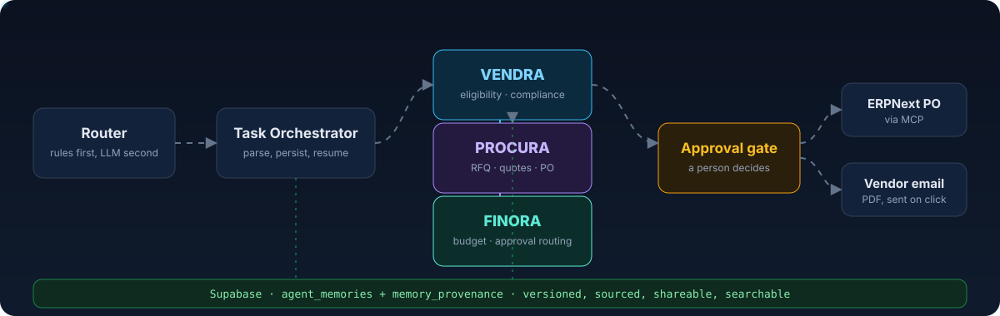
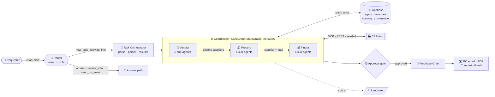
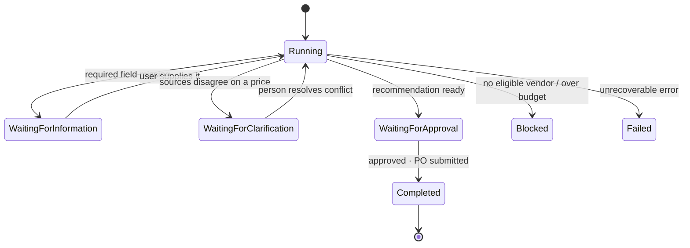
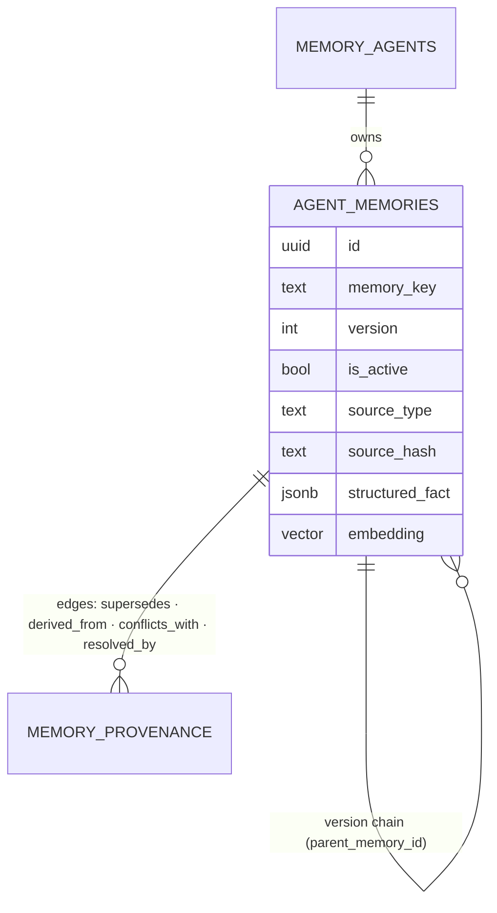
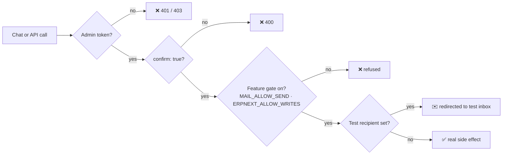

<div align="center">



<br/>

**Three specialist agents. One durable memory. Every answer traceable to its source.**

<br/>

[](#-quick-start)
[](#-api-surface)
[](#-architecture)
[](#-memory-platform)
[](#-configuration)
[](#-erp-integration)
[](#-observability)
[](#-frontend)
[](#-testing)

[Quick start](#-quick-start) ·
[Architecture](#-architecture) ·
[Memory](#-memory-platform) ·
[Safety](#-safety-model) ·
[API](#-api-surface) ·
[Roadmap](#-status--roadmap)

</div>

---

## ✨ What it does

> *"Purchase 10 laptops with 16 GB RAM, within ₹6,00,000, delivered to our Mumbai office within 20 days."*

One sentence becomes a durable, versioned **Purchase Request**. It runs through three agents in a fixed order, ends in a human approval, and can finish as a real **ERPNext Purchase Order** plus a vendor email with the PO attached as a PDF.

<div align="center">

</div>

| | Capability | How |
|---|---|---|
| 🧭 | **Deterministic where it matters** | Quote ranking, budget checks, eligibility and approval limits are plain code. The LLM only routes, narrates and answers. |
| 🧠 | **Persistent, versioned memory** | Every fact is an atomic version in Postgres. Tasks survive restarts, browser sessions and missing information. |
| 🔗 | **Provenance on every record** | Source type, source hash, verifier, task and message links, plus ancestry and descendant graphs. |
| 🔀 | **Conflict and staleness aware** | An email quote vs. an updated PDF is detected, ranked by source authority, and escalated to a person when it is a tie. |
| 🛡️ | **Fail-closed writes** | Admin token + explicit `confirm: true` for POs and mail. Mail is test-redirected and gated behind `MAIL_ALLOW_SEND`. |
| 🔭 | **Observable** | Every chat turn, agent step, model call and ERP call is a Langfuse span, with a built-in dashboard. |

---

## 🏗️ Architecture



### The three agents

| Agent | Responsibility | Sub-agents |
|---|---|---|
| 🔎 **Vendra** | Decides who is *allowed* to quote before anything else runs. | `vendor_discovery` · `document_verification` · `vendor_onboarding_readiness` · `vendor_profile` · `vendor_performance_snapshot` · `vendor_risk_flagging` |
| 📦 **Procura** | Collects and ranks real quotes from eligible suppliers only; prepares the PO. | `rfq_management` · `quotation_processing` · `quotation_comparison` · `supplier_matching` · `delivery_schedule_estimation` · `quotation_history` · `submit_purchase_order`<sup>†</sup> |
| 💰 **Finora** | Checks real numbers before anything is recommended. | `budget_verification` · `cost_analysis` · `invoice_matching` · `payment_terms_review` · `approval_routing` · `financial_records` |

<sup>†</sup> Runs only after approval. Every sub-agent is a plain `(context, results) -> dict` function run through a shared pipeline (`subagents/base.py`); an exception becomes an `error` result instead of crashing the run.

### Design principles

| Principle | In practice |
|---|---|
| **No cycles by construction** | Routing is a Python function over a fixed dependency order, not a step-capped loop. |
| **Rules before models** | Missing-field replies, vendor info, and "send the PO email" are decided by regex in `chat_router.py`. When this was left to the LLM it misrouted about 1 message in 3. |
| **Persist before you run** | The Purchase Request is saved before any agent executes, so a crash never loses the task. |
| **Honest by default** | A missing email, phone or budget is reported as "not on file", never invented. |
| **No silent fallback** | ERPNext backend is MCP, REST or seeded data, chosen by what is configured, and never swapped quietly. |

### Task state machine



---

## 🧠 Memory platform

The memory layer is the foundation the agents sit on; it also ships a standalone five-agent LangGraph demo (Supervisor, Planner, Researcher, Executor, Validator).



| Feature | Module | Behaviour |
|---|---|---|
| **Atomic versioning** | `memory/versioning.py` + SQL functions | One active version per key, enforced by a partial unique index. Nothing is overwritten. |
| **Provenance** | `memory/provenance_fields.py` | Exact source document, content hash, verification state, task and message linkage. |
| **Propagation** | `memory/propagation.py` | Evidence is shared along Vendra → Procura → Finora with a sharing policy and a recorded edge. |
| **Staleness** | `memory/staleness.py` | Shared copies go stale when the origin changes; documents go stale when they expire. |
| **Conflicts** | `memory/conflicts.py` | Competing claims (email vs. PDF) are ranked by source authority; ties wait for a person. |
| **Summaries** | `memory/summaries.py` | Summary-first retrieval for long histories, such as quotation history and conversation memory. |
| **Vector search** | `memory/search.py` | pgvector similarity over embeddings (OpenAI). |

> [!NOTE]
> Memory is always **identity-scoped**: an agent's token can read and write only its own space unless a share edge exists.

---

## 🛡️ Safety model



- 🔒 **Fail closed.** The API returns 503 without `MEMORY_API_TOKEN`. ERPNext writes stay refused until `ERPNEXT_ALLOW_WRITES` is set.
- 🧯 **No silent sends.** A PO email is *drafted* automatically and *sent* only when a person presses **Send email**.
- 🧪 **Test mode.** With `MAIL_TEST_RECIPIENT` set, every mail goes to that address, with the real vendor named in the body prefix.
- 🚦 **Bounded follow-ups.** `MAIL_FOLLOWUP_DAYS` (default 3) and `MAIL_MAX_FOLLOWUPS` (default 2).
- 🔑 **Secrets stay local.** `.env` is gitignored and never echoed; keys do not reach the browser.

---

## 🚀 Quick start

```bash
git clone https://github.com/suryasingawarapu/Procura-AI.git
cd Procura-AI

python -m venv .venv
.venv/Scripts/activate            # Windows · use `source .venv/bin/activate` on macOS/Linux
pip install -r requirements-dev.txt

cp .env.example .env              # then fill in the values (see Configuration)

# build the UI (served at /app)
cd web && npm install && npm run build && cd ..

# run the API + UI
uvicorn app.api.main:app --port 8000
```

Open **http://127.0.0.1:8000/app/** for the chat workspace and observability dashboard.

> [!TIP]
> No ERPNext yet? Leave the `ERPNEXT_*` variables unset and the procurement system runs against clearly-labelled seeded data.

### Database

Apply `migrations/` **by hand, in order**, in the Supabase SQL editor (see [`migrations/README.md`](migrations/README.md)).

| Migration | Purpose |
|---|---|
| `001_harden_schema` | Agent registry, sharing policy, constraints, one-active-version index |
| `002_memory_functions` | The six atomic SQL functions + self-test |
| `003_verify_after_apply` | Read-only verification queries |
| `004_fix_parent_memory_id_fkey` | Correct `parent_memory_id` delete action |
| `005_restrict_direct_table_access` | Revoke direct table DML for `anon` / `authenticated`; `SECURITY DEFINER` + pinned `search_path` |
| `006_procurement_provenance_fields` | Provenance columns for Vendra / Procura / Finora |
| `007_register_coordinator` | Register the coordinator identity |
| `008_allow_conflict_relationships` | Permit `conflicts_with` edges |
| `ROLLBACK` | Undo 001 + 002 (**destructive**) |

> [!WARNING]
> The configured Supabase project is shared and long-lived. Treat every write as a production write.

---

## ⚙️ Configuration

See [`.env.example`](.env.example) for every variable.

| Variable | Required | Purpose |
|---|:---:|---|
| `SUPABASE_URL` · `SUPABASE_KEY` | ✅ | All memory reads and writes |
| `MEMORY_API_TOKEN` | ✅ | Admin token; API fails closed without it |
| `MEMORY_API_TOKEN_<AGENT>` | – | Per-agent scoped token (`_VENDRA`, `_RESEARCHER`, …) |
| `NVIDIA_API_KEY` | ✅ | Nemotron 3.5 Lightning, the default LLM (`AGENT_LLM_MODEL`) |
| `OPENAI_API_KEY` | – | Embeddings (always OpenAI); optional alternate chat LLM |
| `ERPNEXT_URL` · `_API_KEY` · `_API_SECRET` | – | Live ERPNext; without all three, seeded data is used |
| `ERPNEXT_ALLOW_WRITES` | – | Off by default; gates every ERP write |
| `LANGFUSE_PUBLIC_KEY` · `_SECRET_KEY` · `_BASE_URL` | – | Tracing; a no-op unless both keys are set |
| `LANGFUSE_ENABLED` · `LANGFUSE_CAPTURE_CONTENT` | – | Kill switch · withhold prompt/reply text |
| `COMPOSIO_API_KEY` · `COMPOSIO_GMAIL_ACCOUNT` | – | Gmail via Composio MCP (consumer key, sent as `x-consumer-api-key`) |
| `MAIL_TEST_RECIPIENT` · `MAIL_ALLOW_SEND` | – | Redirect every mail · allow sending at all |
| `MAIL_FOLLOWUP_DAYS` · `MAIL_MAX_FOLLOWUPS` | – | Follow-up cadence and cap |

---

## 🏭 ERP integration

The ERP backend is selected by what is configured, in this order, with **no silent fallback**:

| Priority | Client | When |
|:---:|---|---|
| 1 | `MCPERPNextClient` | `ERPNEXT_MCP_SERVER_ENTRY` set. Real MCP stdio client with a tool allowlist; `delete`, `submit`, `cancel` and `call_method` are never called. |
| 2 | `ERPNextRestClient` | `ERPNEXT_URL` + key + secret. Verified live against ERPNext v16. |
| 3 | `SeededERPNextClient` | Nothing configured. Deterministic demo data. |

Live verification caught two bugs mocks had missed: list endpoints return only `name` unless `fields=` is explicit, and REST filters cannot reach child-table fields such as `Supplier Quotation Item.item_code`.

---

## ✉️ Vendor email

After a PO is submitted, an email to the vendor is **drafted**. A person sends it; replies and follow-ups are tracked as Procura memories (`source_type="email"`).

```text
draft ──▶ sent ──▶ followed_up ──▶ replied
 │         │
 │         └─ PDF attached (reportlab → Composio upload → Gmail)
 └─ body is a short cover note; the PO itself is the PDF
```

**In the chat**

| Say | You get |
|---|---|
| `give me the selected vendor information` | Real supplier email, phone, website, country and quotation, with "not on file" for gaps |
| `send the purchase order email to the vendor` | A card with To, Subject, the PDF name and a **Send email** button |

Both are recognised by rules in `chat_router.py`, not by the LLM.

<details>
<summary><b>REST endpoints</b> (admin only)</summary>

| Method | Path | Purpose |
|---|---|---|
| `POST` | `/procurement/mail/draft` | Draft the PO email for an approved request |
| `POST` | `/procurement/mail/{id}/send` | Send it (needs `confirm: true` and `MAIL_ALLOW_SEND=1`) |
| `POST` | `/procurement/mail/check-replies` | Read open threads, record replies |
| `POST` | `/procurement/mail/followups` | In-thread reminders for unanswered mail |
| `GET` | `/procurement/mail` · `/procurement/mail/status` | List and settings |

</details>

---

## 🖥️ Frontend

`web/` is a Vite + React 18 + TypeScript app served by FastAPI at `/app`.

| Page | Highlights |
|---|---|
| **Landing** | Product overview |
| **Chat workspace** | SSE streaming, live pipeline progress, structured task cards, vendor info, mail card with **Send email** |
| **Observability** | KPIs, charts and a record drawer reading Langfuse through admin-only endpoints |

`framer-motion` · `recharts` · `react-markdown` · `lucide-react`. Without a build, the server falls back to the static pages in `frontend/`.

```bash
cd web
npm run dev        # hot reload on :5173, proxies the API on :8000
npm run build      # type-check, then write web/dist
```

---

## 🔭 Observability

Every chat message, task run and approval is traced to Langfuse (`app/observability/langfuse_tracing.py`).

| Convention | Value |
|---|---|
| Trace names | `Procurement Coordinator - <step>` |
| Tags | `agent:<slug>` · `env:<env>` |
| `user_id` | `X-User-Id` header |
| `session_id` | Conversation id |
| Child observations | Router, narration, extractor and summarizer model calls · Vendra / Procura / Finora steps · ERPNext tool calls |
| Failures | Marked `ERROR` |

The dashboard reads Langfuse through `GET /observability/{status,summary,recent}`. The keys never reach the browser.

---

## 🔌 API surface

Interactive docs at **`/docs`** while the server runs.

| Area | Endpoints |
|---|---|
| **Chat** | `POST /procurement/chat` · `POST /procurement/chat/stream` (SSE) |
| **Tasks** | `POST /procurement/tasks` · `/tasks/start` · `/tasks/{pr_id}/resume` · `/requests` · `/requests/{pr_id}/approve` |
| **Vendors** | `GET/POST /procurement/vendors` · `/vendors/import` · `/vendors/{code}/status` |
| **Purchase orders** | `POST /procurement/purchase-orders` (admin + `confirm: true`) |
| **Knowledge** | `/procurement/quotation-claims` · `/procurement/conflicts` · `/conflicts/resolve` |
| **Memory** | `/agents/{id}/memories` · `/versions` · `/ancestry` · `/descendants` · `/share` · `/memory-health` · `/summaries` |
| **Mail** | `/procurement/mail/*` |
| **Ops** | `GET /health` · `GET /procurement/health` · `/observability/*` |

---

## 🧪 Testing

```powershell
.\scripts\run_tests.ps1                  # full suite
.\scripts\run_tests.ps1 tests\unit       # no database, no network
.\scripts\run_tests.ps1 -m "not integration"
```

| Layer | Scope |
|---|---|
| `tests/unit` | Pure logic. Supabase, ERPNext, Gmail and the LLM are faked. **706 passing** at the last full run. |
| `tests/integration` | Read-only `SELECT` checks, with a fixture that compares row counts before and after every test. |
| `-m dbwrite` | Opt-in write tests against real Supabase, needing `MEMORY_ALLOW_WRITE=1`. |

**End-to-end proof against real services**

```bash
python scripts/verify_memory_system.py      # every memory feature, on tagged throwaway data it deletes
python scripts/live_e2e_check.py            # NVIDIA + Supabase  (needs MEMORY_ALLOW_WRITE=1 and RUN_LIVE_LLM_TEST=1)
python scripts/live_nvidia_persistence_check.py   # a live agent saves a finding, a later task retrieves it
```

`verify_memory_system.py` covers versioning, provenance, the Vendra → Procura → Finora memory path, staleness, conflicts, summaries, vector search and an audit of real data. Flags: `--keep`, `--no-llm`, `--cleanup-leftovers`.

---

## 🗂️ Repository layout

```text
app/
├─ api/            FastAPI app · procurement, mail and observability routers · auth
├─ agents/         five-agent LangGraph demo workflow
├─ memory/         store · versioning · propagation · provenance · staleness · conflicts · summaries · search
├─ procurement/
│  ├─ systems/     vendra · procura · finora
│  ├─ subagents/   18 pipeline sub-agents + shared runner
│  ├─ mcp/         ERPNext clients (MCP · REST · seeded)
│  ├─ mail/        composio · outbox · pdf · service
│  ├─ coordinator.py · chat_router.py · task_orchestrator.py · calculations.py
│  └─ vendor_master.py · quotation_claims.py · workflow.py · narration.py
├─ observability/  Langfuse tracing
└─ tools/          identity-scoped LangChain memory tools
web/               Vite + React + TypeScript UI
frontend/          static fallback UI
migrations/        additive SQL, applied by hand
scripts/           live checks, seeding, verification
tests/             unit · integration
docs/assets/       README graphics
```

---

## 📍 Status & roadmap

| | Item |
|:---:|---|
| ✅ | Vendra → Procura → Finora pipeline, deterministic comparison and budget checks |
| ✅ | Versioned, provenance-aware memory with staleness, conflicts and summaries |
| ✅ | Live ERPNext via REST; MCP client implemented and unit-tested |
| ✅ | React chat + observability, SSE streaming, Langfuse tracing |
| ✅ | Vendor email with PDF attachment, follow-ups and reply tracking |
| 🚧 | Scheduler for automatic follow-ups and reply polling |
| 🚧 | Parsing vendor reply content into structured quotation claims |
| 🚧 | Mail list and reply views in the UI; company logo on the PO PDF |
| 🚧 | Multi-task study of memory reuse (current single-task result: no speedup, only a durable provenance record) |
| 🔭 | Vendor onboarding workflow and delivery tracking, once real source data exists |

Known limitations and design trade-offs are written up in [`PROJECT_OVERVIEW.md`](PROJECT_OVERVIEW.md) (§7–8) and [`IMPLEMENTATION_STATUS.md`](IMPLEMENTATION_STATUS.md).

---

## 📚 Further reading

| Doc | What is in it |
|---|---|
| [`PROJECT_OVERVIEW.md`](PROJECT_OVERVIEW.md) | Full report: problem, architecture, request lifecycle, results, decisions, prompts |
| [`IMPLEMENTATION_STATUS.md`](IMPLEMENTATION_STATUS.md) | What is built, verified and open |
| [`migrations/README.md`](migrations/README.md) | Migration order, verification and rollback |

<div align="center">
<sub>Built with LangGraph · FastAPI · Supabase · NVIDIA Nemotron · ERPNext · Langfuse</sub>
</div>
